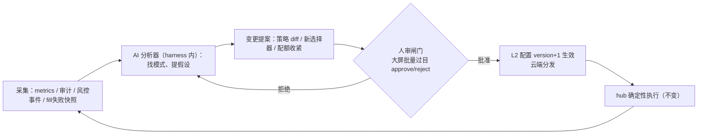

# Maitian-Hub · 自进化能力实施规格书 v1.0（自包含版，交实现 LLM 直接执行）

> 文档性质：交给 LLM/工程师直接实现的完整规格。目标读者对本项目零背景。
> 基线：本规格基于 marketing-ops-hub 仓库现状（main 分支，含红线 1 v2 auto 发布）撰写。动手前先 `git clone` 仓库并通读 `README.md` 与 `content-hub/SKILL.md`。
> 阅读顺序强制：§1 前因 → §2 架构分层与总设计 → §3 约束 → §4 分回路规格 → §5 里程碑 → §6 执行纪律。

## 1. 前因（为什么方案长这样——先读懂再动手）

### 1.1 系统现状（已建成并部署）

本项目是「多平台账号矩阵运营系统」：用户对**自有账号**（小红书/抖音/TikTok/YouTube/Bilibili/闲鱼/X，每平台 ≤5 个）做素材发布、互动养号、私聊、数据复盘。已在生产运行的部分：

- **Harness 层**（唯一的 LLM agent）：用户本机的 Claude Code / Codex / WorkBuddy 装载 `content-hub/` skill 包，负责编排、文案改写（L1）、互动目标选择。
- **hub 执行层**（`backend/src/`，Node ≥22.5 零依赖）：确定性程序，零 LLM——调度排期、SQLite 状态机、防重、配额、风控即停、审计、大屏(:8787)。账号支持 `--mature`（老号跳过冷启动）与 `--auto-publish`（auto 模式自动发布，红线 1 v2）。
- **maitian-cloud**（`backend/cloud/`）：云素材库 API（workspace_key 鉴权），nginx 统一网关(:2680)。
- **ego lite**：用户本机 AI 浏览器，唯一执行层；适配器读取知识包 JSON（`content-hub/docs/knowledge/<platform>.json`）执行页面操作，**代码零写死选择器**。

### 1.2 问题：现在的「智能」不会随数据变好

当前 harness 改写文案、选择互动目标的行为是静态的——不管发出去的内容表现好坏，策略永远一样。用户已拍板要给系统加「自进化」能力：让系统从自己的复盘数据（metrics 表，发布后第 1/3/7 天自动采集）里学习，逐步改进文案策略与页面适配。

### 1.3 关键架构判断（本规格的地基，不得更改）

1. **进化只发生在配置层（L2）与 Harness 层（L1），hub 执行层（L3/L4）一行不改**（唯一例外：回路④的配额收紧写入，见 §4.4）。进化产物=版本化的 JSON 数据，出问题回滚版本号即可。
2. **一切进化产物必须过人审**才生效——「自进化」绝不等于「自放飞」。人审闸门在大屏/会话完成。
3. **安全边界不进进化回路**：11 条红线、ego 十条坑位、配额硬闸、防重约束是约束条件而非策略，任何回路不得触碰或提议修改。
4. **分析器复用 harness**（用户会话内说「生成周策略报告」），不新建常驻 AI 服务——与现有架构同构，成本为零。

### 1.4 系统五层（进化回路的映射框架）

```
L1  Harness 层   Claude Code 等 + content-hub skill        ← 所有 AI 分析、提议在这层发生
L2  策略/知识层   knowledge/*.json（已有）
                 + strategies/*.json（本规格新增）           ← 进化产物都落在这一层
L3  hub 执行层   planner/状态机/配额/审计（确定性）          ← 不改（例外：回路④收紧写入）
L4  适配器代码   adapters/*.mjs（读 L2 配置执行）            ← 不改；流程级变化走人工开发
L5  云端         maitian-cloud                              ← 回路②的热更分发点
```

## 2. 总设计：进化闭环



四条回路总览（优先级即实现顺序）：

| 回路 | 进化什么 | 产物所在层 | 分析在哪跑 | 动 L3/L4 吗 |
| --- | --- | --- | --- | --- |
| ① 文案策略 | 哪类标题/标签/时段表现好 | `strategies/<platform>.json`（新） | harness 会话 | 否 |
| ② 知识包自愈 | 平台改版后选择器修复 | `knowledge/<platform>.json`（已有） | harness 会话 | 否 |
| ③ 互动目标学习 | 哪类目标转化高 | `strategies/<platform>.json` 的 engage 段 | harness 会话 | 否（后续加只读采集扩展） |
| ④ 节奏收紧 | 按风控反应下调配额 | hub DB 账号级覆盖 | harness 提议 | **仅收紧写入（代码强制 ≤ 基线）** |

## 3. 全局约束（实现前抄进你的任务清单）

1. 仓库纪律：零第三方依赖（node:sqlite/node:http）；选择器一律进知识包，代码写死 hash 类名视为 bug；`bash test/redline-check.sh` 必须保持三关全过；`node test/smoke.mjs` 全过（当前基线 69/69，你新增功能须带新测试）。
2. 红线全文见 `content-hub/SKILL.md`（v2）：发布内容人审前移；风控即停；凭据零接触；**回路④只许收紧**。
3. 策略库/提案文件是纯 JSON，禁止任何 agent 专有语法（D6 跨 agent 兼容）。
4. 未实现 ≠ 假装实现：交付说明逐条标注已验证/未验证。
5. 不卡住原则：同一操作重试 2 次失败 → 停，输出状态+已试+≥2 个下一步。

## 4. 分回路规格

### 4.1 回路①：文案策略库 + 周分析（E1，先做，数据现成）

**目标**：AI 改写文案时不再凭通用经验，而是参考「你的号上真实数据验证过的策略」。

**L2 数据结构**——`strategies/<platform>.json`（七平台各一，初始文件由实现生成，内容为空策略+说明）：

```json
{
  "platform": "bili",
  "version": 1,
  "updated_at": "2026-11-24T00:00:00Z",
  "source": "initial",
  "title_patterns": [
    { "pattern": "疑问句式标题", "evidence": {"avg_views_ratio": 1.8, "samples": ["p-xxx","p-yyy"]}, "confidence": 0.6 }
  ],
  "tag_patterns": [],
  "timing": { "best_hours": [20, 21], "evidence": "day1 views 按发布小时分组对比" },
  "notes": []
}
```

**hub 侧新增**（L3，只读供数——不改状态机）：
- `hub strategy show <platform>`：输出当前策略库 JSON。
- `hub strategy history <platform>`：versions 目录列表（见下）。
- `hub proposal list|approve <id>|reject <id>`：提案队列（SQLite 新表 `proposals(id, kind, platform, payload JSON, status drafted|approved|rejected|applied, created_at, decided_at, applied_version)`；DDL 加表，轻量迁移同 auto_publish 先例）。
- metrics 已有，无需改；复盘卡 `hub review` 已有。

**harness 侧新增**（L1，`content-hub/SKILL.md` 加触发词「生成策略报告」）：
1. 读 metrics+posts（近 14 天）→ 按标题模式/标签/发布小时分组对比 → 产出 `proposals/strat-<ts>.json`（diff 格式：当前策略 vs 提议策略 + 每条 evidence）→ 写入 proposals 队列。
2. 用户在大屏（提案队列区块）或 `hub proposal approve` 人审。
3. 批准 → hub 将新策略写 `strategies/<platform>.json`，旧版归档 `strategies/versions/<platform>-v<n>-<ts>.json`（保留最近 10 版）。

**消费路径**：SKILL.md「发一条」流程第④步（AI 改写）前，harness 先 `hub strategy show <platform>` 读策略，作为改写依据；差异表里标注「依据策略 v<n>」。

**验收**：造 8 条假 metrics 数据 → 「生成策略报告」产出含 evidence 的提案 → approve → 策略库 version=2 且 versions/ 有归档 → 「发一条」改写时引用策略。冒烟测试覆盖：proposal 队列 CRUD、版本归档、策略消费读取。

### 4.2 回路②：知识包自愈 + 云端热更（E2）

**目标**：平台改版打断适配器时，从「人工抓包改 JSON」升级为「AI 读现场提议 + 人审 + 云端热更」。

**失败现场采集**（hub 侧，L3 小改——仅在失败路径补记录，不动状态机逻辑）：
- fill/verify/collect 失败且带 shot 时，hub 已存 `posts.error`/`audit_log.shot`。新增：失败时同时把 round 脚本内抓取的**页面 innerText 前 4000 字**存入 `audit_log.detail`（round-runtime 在 catch 分支补采，字段 `dom_snapshot`）。不新增表。

**热更分发**（L5，maitian-cloud 新增两个端点）：
- `GET /v1/knowledge?platform=bili` → `{ok, json, version, updated_at}`（鉴权同素材 API）。
- `PUT /v1/knowledge/:platform` → 上传新版本（body 带 base_version 做乐观锁；version 冲突 409）。
- 存储：`data/knowledge/<platform>.json` + versions 归档。
- hub 启动时与 daemon 每 30 分钟：`hub knowledge sync`——云端 version > 本地则拉取覆盖本地文件（本地被改过且未推送时先归档再覆盖，绝不静默丢失）。

**自愈流程**（L1，SKILL.md 加触发词「修复 <platform> 适配器」）：
1. 前提：该平台存在 failed 记录且带 dom_snapshot/截图。
2. AI 读现场材料 → 对照知识包当前版本 → 产出提案：仅限**字段级修改**（`*_sel`、`*_text`、`form_ready_text`、`risk` 数组），禁止改 `steps` 流程结构、禁止改 `cadence`/`limits`（那些走人工）。
3. 提案入 proposals 队列（kind=knowledge）→ 人审 → approve 后 hub 写本地知识包（version+1）→ `PUT /v1/knowledge/:platform` 推云端 → 其他设备 `knowledge sync` 拉到。
4. 提案必须附 `basis: "dom_snapshot"` 或 `"screenshot"`，无依据的提案 hub 直接拒绝入库。

**验收**：人为把 bili 知识包 `submit_text` 改错 → run 失败且 audit_log 带 dom_snapshot → 「修复 bili 适配器」产出提案 → approve → 本地 version+1、云端可拉到、第二台设备 sync 后一致。冒烟覆盖：cloud knowledge 端点 CRUD、sync 乐观锁冲突 409、提案 basis 校验。

### 4.3 回路③：互动目标学习（E3，数据积累慢，最后做）

- 策略库增加 `engage` 段：`{"target_traits": [{"trait": "1w-10w粉 同领域号", "evidence": {...}, "confidence": 0.5}]}`
- 数据源：engagements（executed 的 kind/target）+ 目标页后续反馈。**反馈采集本期只做占位**：`hub proposal` 流程同①；「追踪目标页反馈」需要一个只读 collect 扩展（round 脚本进目标页读粉丝/互动数），实现为独立小功能，不阻塞 E1/E2。
- 消费路径：SKILL.md「养号巡检」选目标时读策略 engage 段。

### 4.4 回路④：配额收紧自适应（E4，谨慎，可与 E2 并行）

- **方向锁死**：只许收紧（下调），禁止放宽超过 `config.json` 基线。clamp 在 hub 代码里强制，不靠提示词。
- hub 新增：`accounts.quota_override` 列（JSON，轻量迁移）；`quotaOf()` 计算顺序：cold 规则 > quota_override（≤ 基线 clamp）> 基线×trust。
- 提案来源：AI 分析 RISK_SIGNAL 审计（某号风控频发 → 提议下调该号 like/comment）；提案 kind=quota，payload 带新旧值，approve 后写入 quota_override 并审计。
- SKILL.md 明文：进化回路不得提议任何放宽；收到此类提议直接拒绝并记录。

**验收**：风控事件注入后提案下调 → approve → `hub health` 显示 override 生效且 ≤ 基线；提案上调 → hub 拒绝入库。

## 5. 里程碑与验收顺序

| M | 内容 | 验收 |
| --- | --- | --- |
| E1（2d） | 回路①：proposals 表+CLI+策略库+版本归档+SKILL 触发词 | §4.1 验收全过；smoke 全绿 |
| E2（3d） | 回路②：失败现场采集+cloud 知识包端点+sync+自愈提案 | §4.2 验收全过；两设备 sync 一致 |
| E4（1d） | 回路④：quota_override+收紧 clamp+提案 | §4.4 验收全过；上调被拒 |
| E3（1d+） | 回路③：engage 策略段+选目标消费（反馈采集占位） | 策略读取生效即可 |

按 E1→E2→E4→E3 顺序；每个里程碑先跑验收再进下一个。

## 6. 执行纪律（给实现 LLM 的硬性指令）

1. 动手前：clone 仓库 → 通读 `README.md`、`content-hub/SKILL.md`、`backend/src/planner.mjs`（状态机）、`backend/src/db.mjs`（DDL 与轻量迁移先例）、`test/smoke.mjs`（测试风格）。
2. 每个 L2 文件都必须 `version` + `versions/` 归档 + 乐观锁；任何覆盖写先归档。
3. proposals 是唯一进化入口：harness 不得直接改 L2 文件生效，必须走提案→人审→hub 落地。
4. 全部新功能配 smoke 测试；`bash test/redline-check.sh` 保持三关全过。
5. 交付说明必须包含：目录结构 diff、新 CLI 命令表、每条回路的实测验证结果、未验证项清单（如实标注）。
6. 风险上报触发词：实现中发现需要改 L3/L4 才能完成的需求（回路④ clamp 除外）→ 停，报告，等待人类决策——那说明需求越界了。
